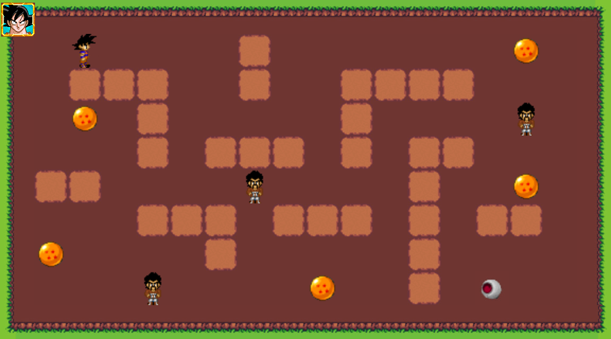
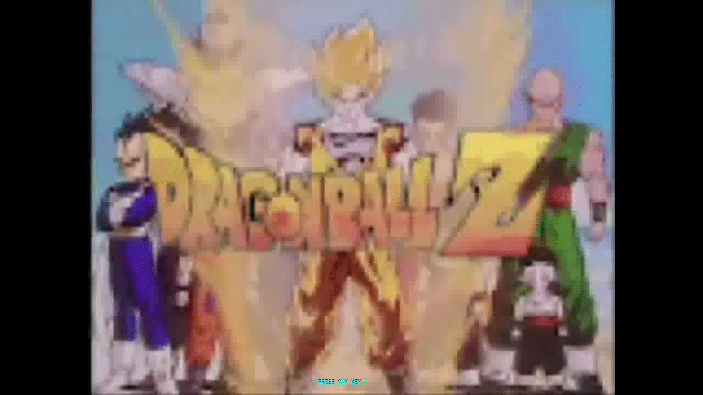
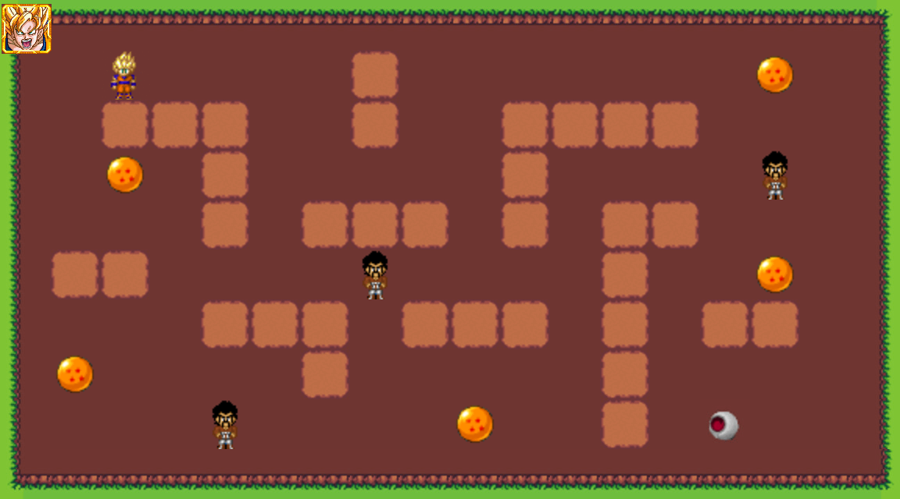
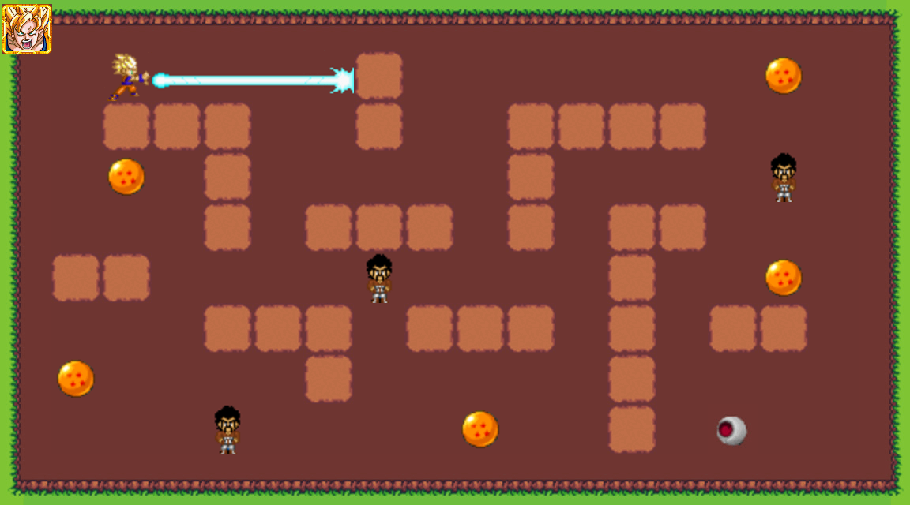

# my_so_long

Bienvenue dans mon repository **my_so_long** ! Ce projet est un petit jeu 2D en vue du dessus, écrit en C avec la bibliothèque graphique **MiniLibX** (X11). Le joueur se déplace sur une carte chargée depuis un fichier `.ber`, ramasse tous les objets puis rejoint la sortie. L'objectif est d'apprendre à gérer une fenêtre graphique, les événements clavier, l'affichage de sprites et d'animations, ainsi que la lecture et la validation d'une carte.



## Sommaire

- [À propos](#à-propos)
- [Fonctionnalités](#fonctionnalités)
- [Installation](#installation)
- [Utilisation](#utilisation)
- [Structure du projet](#structure-du-projet)
- [Contributions](#contributions)

## À propos

**my_so_long** lit une carte rectangulaire décrite caractère par caractère, vérifie qu'elle est jouable, puis l'affiche dans une fenêtre en cases de 64 × 64 pixels. Le jeu commence par une intro animée, puis le joueur peut se déplacer, se transformer, attaquer les ennemis et terminer le niveau.

Le projet s'appuie sur trois bibliothèques internes :

- **libmy** (`include/libmy`) : fonctions utilitaires sur les chaînes, la mémoire et les listes chaînées, compilées dans `libmy.a`.
- **my_printf** (`include/printf`) : réimplémentation de `printf`, compilée dans `libmyprintf.a`.
- **get_next_line** (`include/GNL`) : lecture d'un fichier ligne par ligne, utilisée pour charger la carte.

## Fonctionnalités

### 1. Intro animée

Au lancement, une fenêtre de 1280 × 720 joue une animation de 60 images, puis affiche « PRESS ANY KEY ! ». N'importe quelle touche lance la partie, `Échap` quitte le programme.



### 2. Lecture et validation de la carte

Le programme refuse de démarrer (`Error`) si :

- le fichier ne se termine pas par `.ber`, n'existe pas ou est vide ;
- les lignes n'ont pas toutes la même longueur ;
- la carte n'est pas entièrement entourée de murs (`1`) ;
- elle ne contient pas exactement un joueur (`P`), exactement une sortie (`E`) et au moins un objet (`C`) ;
- un élément n'est pas accessible depuis la position du joueur (vérification par *flood fill*).

### 3. Affichage de la carte

Les murs du bord sont dessinés automatiquement avec la bonne texture selon leur position (coins, haut, bas, côtés). Les murs intérieurs ont leur propre texture. Un portrait du personnage s'affiche en haut à gauche de la fenêtre.

### 4. Déplacements

- Déplacement case par case avec une animation de marche dans les quatre directions.
- Le joueur ne peut pas traverser les murs ni les ennemis.
- Le nombre de déplacements s'affiche dans le terminal (`deplacement = N`).
- Le joueur peut passer sur la sortie ; la partie se termine lorsqu'il l'atteint après avoir ramassé tous les objets.

### 5. Transformation

La touche `Espace` déclenche une animation de transformation : le personnage change d'apparence, ses sprites de déplacement changent et le portrait est mis à jour. Un nouvel appui sur `Espace` le ramène à sa forme normale.



### 6. Attaques et ennemis

Les ennemis (`H`) sont placés sur la carte et bloquent le passage. La touche `E` déclenche une attaque dans la direction du dernier déplacement :

- **forme normale** : attaque au corps à corps, qui élimine l'ennemi situé sur la case voisine ;
- **forme transformée** : un kamehameha, rayon animé qui avance jusqu'au premier obstacle et élimine tous les ennemis sur son passage.



## Installation

### Prérequis

- Linux : un serveur X11 et les en-têtes de développement (`libx11-dev`, `libxext-dev`).
- macOS : [XQuartz](https://www.xquartz.org/), par exemple avec `brew install --cask xquartz`.

### Compilation

```sh
git clone https://github.com/AxelPj/my_so_long.git
cd my_so_long
make
```

Cette commande compile la MiniLibX, `libmy.a`, `libmyprintf.a`, puis génère l'exécutable `so_long`.

Autres règles disponibles :

```sh
make clean    # supprime les fichiers objets (dossier build/ et objets des bibliothèques)
make fclean   # supprime aussi l'exécutable et les bibliothèques compilées
make re       # recompile tout
make debug    # recompile tout avec -fsanitize=address
make mac      # macOS : vérifie XQuartz, compile, ouvre XQuartz puis lance le jeu
```

## Utilisation

Lancez le jeu en lui donnant une carte :

```sh
./so_long map/map3.ber
```

Sur macOS, `make mac` lance directement le jeu avec `map/map3.ber`. Pour choisir une autre carte :

```sh
make mac MAP=map/map2.ber
```

### Commandes

| Touche | Action |
| --- | --- |
| `W` / `A` / `S` / `D` | Se déplacer (haut / gauche / bas / droite) |
| `Espace` | Se transformer / revenir à la forme normale |
| `E` | Attaquer (kamehameha en forme transformée) |
| `Échap` | Quitter |

### Créer une carte

Une carte est un fichier texte `.ber` composé des caractères suivants :

| Caractère | Signification |
| --- | --- |
| `1` | Mur |
| `0` | Sol |
| `P` | Position de départ du joueur |
| `C` | Objet à ramasser |
| `E` | Sortie |
| `H` | Ennemi |

Exemple (`map/map3.ber`) :

```
111111111111111111
1P0000010000000C01
101110010011110001
10C010000010000H01
100010111010110001
1110000H0000100C01
100011101110101101
1C0000100000100001
1000H0000C0010E001
111111111111111111
```

## Structure du projet

- `Makefile` : compilation du jeu et des bibliothèques (règles `all`, `clean`, `fclean`, `re`, `debug`, `mac`).
- `include/header/so_long.h` : structures du jeu, constantes et prototypes de toutes les fonctions.
- `src/main/main.c` : point d'entrée, vérification de l'argument et du fichier `.ber`, lancement de l'intro puis de la partie.
- `src/intro/intro.c` : ouverture de la fenêtre d'intro, animation et passage au jeu.
- `src/intro/charge_intro1.c` : chargement des images de l'intro (1re partie).
- `src/intro/charge_intro2.c` : chargement des images de l'intro (fin) et fonction qui les charge toutes.
- `src/intro/charge_intro3.c` : chargement des images de l'intro (partie intermédiaire).
- `src/parsing/parsing.c` : lecture de la carte en mémoire (et copie pour le *flood fill*).
- `src/parsing/verif_map.c` : vérification des murs, des lignes et du nombre de `P`, `E` et `C`.
- `src/parsing/flood_files.c` : recherche du joueur et vérification que tout est accessible (*flood fill*).
- `src/utils/utils_init_struct.c` : initialisation des structures et de la MiniLibX.
- `src/utils/utils_map.c` : ouverture, comptage des lignes et libération de la carte.
- `src/utils/change_map.c` : remplacement des murs par des codes de texture (coins, bords, murs intérieurs).
- `src/utils/draw_img.c` : affichage de la carte et du portrait.
- `src/utils/utils_mlx.c` : création de la fenêtre, gestion des touches et fermeture du jeu.
- `src/img_utils/charge_img_wall.c` : chargement des textures des murs et du sol, des portraits, et appel de tous les chargements d'images.
- `src/img_utils/charge_img.c` : chargement de la sortie, des objets, de l'ennemi et des sprites du joueur (face, dos).
- `src/img_utils/charge_img2.c` : chargement des sprites du joueur (droite, gauche).
- `src/img_utils/charge_img3.c` : chargement des images de l'animation de transformation.
- `src/img_utils/charge_img4.c` : chargement des sprites de la forme transformée (face, dos).
- `src/img_utils/charge_img5.c` : chargement des sprites de la forme transformée (droite, gauche).
- `src/img_utils/charge_img_attaque.c` : chargement des sprites de l'attaque au corps à corps.
- `src/img_utils/charge_img_attaque_ssj.c` : chargement des sprites du joueur qui lance le kamehameha.
- `src/img_utils/charge_img_kamehameha.c` : chargement des sprites du rayon kamehameha.
- `src/img_utils/free_img1.c` : libération des textures et d'une partie des sprites.
- `src/img_utils/free_img2.c` : libération des sprites restants.
- `src/mouv/mouv_sprite1.c` : déplacements en forme normale (collisions, objets, sortie).
- `src/mouv/mouv_ssj1.c` : déplacements en forme transformée.
- `src/mouv/anim.c` : animations de marche en forme normale et fin de la transformation.
- `src/mouv/anim_ssj.c` : animations de marche en forme transformée et début de la transformation.
- `src/mouv/mouv_exit1.c` : animations quand le joueur quitte la case de sortie (forme normale).
- `src/mouv/mouv_exit2.c` : animations quand le joueur quitte la case de sortie (forme transformée).
- `src/attaque/attaque.c` : attaque au corps à corps.
- `src/attaque/compteur_att.c` : compteur qui rythme les animations d'attaque.
- `src/attaque/kamehameha.c` : déclenchement et animation de lancement du kamehameha.
- `src/attaque/kamehameha2.c` : portée du rayon, élimination des ennemis et animation du rayon.
- `include/libmy/` : bibliothèque `libmy` (fonctions `my_*`).
- `include/printf/` : bibliothèque `my_printf`.
- `include/GNL/` : `get_next_line`.
- `include/minilibx/` : MiniLibX (bibliothèque graphique X11).
- `map/` : cartes `.ber` d'exemple.
- `asset/` : images XPM (carte, personnage, transformation, attaques, intro).
- `screenshots/` : captures d'écran utilisées dans ce README.

## Contributions

Les contributions sont les bienvenues ! Pour proposer une modification :

1. Forker ce repository.
2. Créer une branche : `git checkout -b feature/nouvelle-fonctionnalite`
3. Committer : `git commit -m "Ajout d'une nouvelle fonctionnalité"`
4. Pousser : `git push origin feature/nouvelle-fonctionnalite`
5. Ouvrir une Pull Request.
